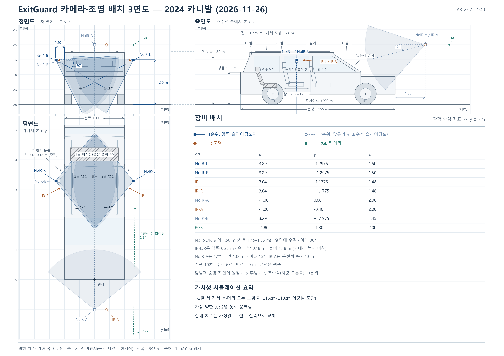
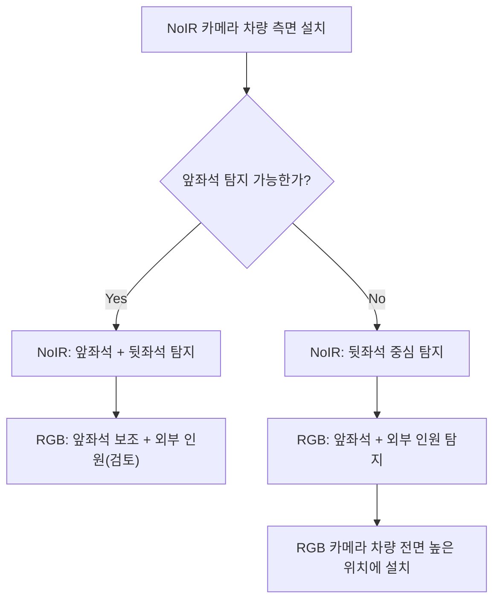

# 기계식 주차장 차량 내 잔류 인원 감지 시스템 — 의사결정 기록

- **팀:** 멈춰조
- **작성일:** 2026-11-26
- **문서 목적:** 프로젝트의 기술적·설계적 결정과 근거를 공유하고, 변경 사항 및 검증 항목을 관리한다.

## 1. 프로젝트 목표

기계식 주차장에 차량을 입고하기 전에 차량 외부 카메라로 내부 잔류 인원을 감지하고, 사람이 남아 있거나 안전 여부를 확인할 수 없는 경우 주차설비의 운전을 제한하는 시스템을 개발한다.

- 운전자뿐 아니라 뒷좌석 동승자, 수면 상태의 탑승자 등도 감지 대상으로 고려한다.
- 차량 내부에 남은 사람의 자발적인 판단이나 조작에 의존하지 않는다.
- 기존 기계식 주차장에 적용하기 쉬운 저비용 온디바이스 시스템을 지향한다.

## 2. 기존 기술 및 문제 정의

### 2.1 기존 기술

현대엘리베이터는 기계식 주차장 리모델링 솔루션을 제시하고 있으며, 피앤씨테크놀로지의 파프리카(Far-Free Car)와 협업한 AI 비전 기반 시스템을 기존 기술로 검토한다. 회의 자료에 따르면 운전자의 퇴장 여부를 인식하여 주차설비를 구동하는 방식이며, CCTV에 포착되는 동승자의 퇴장 확인도 가능한 것으로 추정된다.

### 2.2 기존 기술의 한계

- 차량 외부에서 사람의 출입을 추적하는 방식은 카메라의 사각지대에 있는 탑승자를 놓칠 가능성이 있다.
- 짙은 선팅, 좌석 및 차체에 의한 가림 등으로 뒷좌석 잔류 인원을 직접 확인하기 어려울 수 있다.
- 운전자 퇴장 여부만으로 차량 내부에 사람이 없음을 보장할 수 없다.

회의에서 검토한 2023년 1월 부산 기계식 주차장 추락 사고는 차량 내 잔류 인원을 입고 전에 확인할 필요성을 보여 주는 사례로 활용한다. 회의 자료에 따르면 대리운전 이후 차량에 남은 차주가 주차설비 작동 후 추락한 사례이다.

> 기존 제품의 상세 인식·제어 방식과 사고의 구체적 경위는 회의 자료를 바탕으로 작성했으며, 공식 자료 및 기사 출처를 별도로 확인해야 한다. 기존 제품이 해당 사고를 방지하지 못했다는 의미는 아니다.

### 2.3 차별점

기존의 출입·퇴장 확인 방식에 차량 내부 잔류 인원의 직접적인 감지 절차를 보완한다. 차량 양측 또는 측면 기반 영상 정보를 활용하는 방안을 우선 검토하여, 단일 시점에서 발생하는 사각지대를 줄이고자 한다.

## 3. 의사결정

### DEC-001. 디스플레이 설치 위치

- **상태:** 잠정 · **관련 결정:** DEC-006(UI), DEC-008(SOS)

**결정:** 차량 외부, 주차설비 이용자 또는 관리자가 쉽게 확인할 수 있는 위치에 디스플레이를 설치한다.

**근거:** 차량 내 잔류 인원은 수면, 음주, 건강 상태, 연령 등으로 인해 상황을 인지하거나 대응하기 어려울 수 있다. 따라서 외부 이용자와 관리자가 상태를 확인하고 조치하도록 구성한다.

**후속 작업:** 설치 높이, 시인성, 이용자 동선 및 비상 버튼 접근성을 검토한다.

### DEC-002. 온디바이스 AI 채택

- **상태:** 잠정 · **관련 결정:** DEC-003(성능 비교), DEC-005(구성)

**결정:** 외부 서버를 필수로 사용하지 않고 Raspberry Pi 4에서 영상 입력 및 AI 추론을 수행하는 구조를 기본안으로 한다.

**근거:**

- 별도 추론 서버 및 클라우드 운영 비용 절감 가능
- 서버 의존성 감소 및 시스템 구성 간소화
- 기존 주차시설에 추가 설치하기 용이한 독립형 구조
- 외부 네트워크 연결 없이 로컬 감지 수행 가능
- 차량 내부 영상의 외부 전송을 최소화할 수 있음

**검증 사항:** 실제 장비 비용, 소비전력, 연산 성능, 통신 안정성 및 유지보수 비용을 확인한다. 온디바이스 방식이 항상 더 저렴하거나 부품 수가 적은 것은 아니므로 최종 구성 기준으로 비교한다.

### DEC-003. Raspberry Pi 4와 고사양 PC 성능 비교

- **상태:** 잠정 · **관련 결정:** DEC-002(온디바이스)

**결정:** 동일한 모델, 입력 데이터 및 평가 기준으로 Raspberry Pi 4와 고사양 PC의 성능을 비교한다.

**목적:** 온디바이스 환경의 제약을 정량적으로 확인하고, 목표 성능을 충족하는지 판단한다.

| 측정 지표 | 측정 목적 |
|---|---|
| 모델 파일 크기(MB) | 저장 공간 요구량 비교 |
| 추론 지연시간(ms), 평균 및 P95 | 모델 자체의 처리 성능 비교 |
| FPS | 실시간 처리 가능 여부 확인 |
| 전처리·추론·후처리 시간(ms) | 처리 병목 분석 |
| 전체 처리 지연시간(ms) | 영상 입력부터 결과 출력까지의 응답 시간 확인 |
| CPU/GPU 사용률 및 메모리 사용량 | 장치별 자원 제약 확인 |
| Precision, Recall, F1-score | 사람 검출 성능 비교 |
| 잔류 인원 존재 여부 정확도 및 미검출률 | 실제 시스템의 안전 관련 감지 성능 평가 |
| 인원 수 오차(MAE) | 실제 탑승 인원과 추정 인원 비교 |

**실험 통제 조건:**

- 동일한 모델 가중치, 입력 영상, 입력 해상도, confidence threshold 및 NMS 조건 사용
- 워밍업 이후 각 조건을 60초씩 측정하고 반복 측정 결과 기록
- 모델 추론 시간과 전체 파이프라인 처리 시간을 구분
- 추론 백엔드, 정밀도(FP32/FP16/INT8), 스레드 수, PC 및 Raspberry Pi 사양 명시
- 백엔드나 정밀도가 다른 최적화 실험은 별도 조건으로 구분

- Pi 4는 총 4대이며(DEC-005), 카메라가 달린 Pi(NoIR A·B, RGB)는 각자 영상 1개만 추론한다. 따라서 카메라 Pi는 "영상 1개 추론 + 통신" 조건으로 측정하고, 판정 Pi(C)는 카메라 없이 "판정 + 터치스크린 UI + 음성 + 신호등 출력" 조건으로 따로 측정한다(열 스로틀링 포함).

**미확정:** 최종 사용 모델, 입력 해상도, 최소 FPS 및 허용 지연시간.

### DEC-004. 차량 내부 감지 센서 선정

- **상태:** 잠정 · **관련 결정:** DEC-005(수량), DEC-010(배치)

**결정:** Raspberry Pi NoIR 카메라와 근적외선(NIR) 조명을 이용하여 차량 외부에서 내부 인원을 감지한다. 기본적으로 차량 유리를 닫은 상태에서 촬영하되, 짙은 선팅 등으로 내부 인원 식별이 어려운 경우 이용자에게 해당 차량의 유리창을 내리도록 안내하고 재검사한다.

**근거:** NoIR 카메라는 IR-cut 필터가 없는 카메라로, 근적외선 조명과 조합하여 차량 내부 촬영에 활용할 수 있다. 다만 근적외선 투과율은 차량 유리, 선팅 필름 및 파장에 따라 달라지므로 모든 차량에서 닫힌 유리창을 통한 감지가 가능한 것은 아니다.

**동작 방향:**

1. 차량 유리창을 닫은 상태에서 내부 잔류 인원을 감지한다.
2. 짙은 선팅이나 반사 등으로 내부 확인이 어려운 경우 운전을 제한하고 외부 디스플레이에 유리창 개방 안내를 표시한다.
3. 유리창 개방 후 재검사를 수행한다.
4. 재검사 후에도 안전 여부를 확인할 수 없으면 관리자 확인을 요청한다.

**검증 사항:**

- 선팅 농도, 유리 반사, 주야간 조도에 따른 가시성
- 유리창 개방 전후의 감지 성능 및 재검사 절차
- NIR 조명 ON/OFF 및 조명 각도·거리별 감지 성능
- 운전석, 조수석, 뒷좌석 탑승자 감지 성능
- NoIR 카메라의 정확한 모델, 실제 지원 해상도·프레임레이트 및 구매 가격 확인
- IR 조명의 사용 안전성 및 눈 노출 위험 검토

**미확정:** 내부 확인이 불가능한 상황을 판정하는 기준과 재검사 조건.

> 회의 자료의 카메라 가격(5만 원대), FHD 및 최대 120 FPS는 구매 후보에 관한 참고 정보이며, 동일 해상도에서 120 FPS를 지원한다는 의미는 아니다. 실제 사양과 가격은 모델별로 확인한다.

### DEC-005. 다중 카메라 구성

- **상태:** 잠정 · **관련 결정:** DEC-004(센서), DEC-010(배치)

**잠정 결정:** Raspberry Pi 4 4대로 구성한다. NoIR 카메라 Pi 2대(A·B), RGB 카메라 Pi 1대, 그리고 카메라 없이 판정과 출력만 하는 Pi 1대(C)이다. 차량 양측 촬영을 우선 검토하고, 실험 결과에 따라 카메라 수량을 조정한다.

| 장비 | 수량 | 비고 |
|---|---:|---|
| Raspberry Pi 4 | 4 | NoIR A·B, RGB: 보드별 영상 입력 및 추론 (보드당 카메라 1대) / C: 잔류 인원 판정, 터치스크린·스피커·신호등 출력 (카메라 없음) |
| NoIR 카메라 | 2 | 차량 내부 촬영 |
| 삼각대 | 3 | 카메라 위치 및 각도 고정 (NoIR 2대 + RGB 1대) |
| NIR LED 조명 | 2 (검토) | 조도 및 선팅 조건에 따라 적용 |
| RGB 카메라 | 1 | 앞좌석(운전석 또는 조수석) 감지 및 외부 인원 확인(DEC-010). 전용 Pi 4에 연결한다(보드당 카메라 1대이므로 CSI 단자 부족 문제 없음) |

**보드 연결 (2026-11-26):**

```
[Pi A]   NoIR ─ 내부 인원 모델 ─┐ 유선
[Pi B]   NoIR ─ 내부 인원 모델 ─┤ 유선
                                ├──▶ [Pi C] 잔류 인원 판정 ──▶ 터치스크린 · 스피커 · 신호등
[Pi RGB] RGB  ─ 외부 인원 모델 ─┘ Wi-Fi      (Pi C도 Wi-Fi)
```

- Pi A·B는 유선, Pi C와 RGB Pi는 무선(Wi-Fi)으로 같은 네트워크에 연결한다.
- Pi C가 무선이므로 **모든 보고(A·B·RGB → C)가 Wi-Fi 구간을 지난다.** 통신 실험(EXP-012)에서 Wi-Fi는 지연 기준을 통과하지 못했다(p99 약 65~72 ms, 수신 공백 최대 약 400 ms, 무응답 판정 기준 500 ms, Wi-Fi 절전 켠 상태). 보고가 늦거나 끊기면 판정은 안전한 쪽(판단 불가)으로 가지만, 그 빈도가 높으면 빈 차량도 자주 막힌다. Wi-Fi 절전을 끈 재측정과 판단 기준 조정이 필요하다(미확정).

**근거:** 단일 카메라에서 차체, 좌석, 탑승자 등에 의해 가려지는 영역을 다른 시점으로 보완할 가능성이 있다. 다중 카메라의 성능 개선 폭은 자체 실험으로 검증하며 관련 연구의 출처도 확보한다.

**비교 실험:** 측면 NoIR 한쪽 단독(L 또는 R), 양쪽(L+R) 조합의 미검출률, 정확도, 전체 지연시간, 비용을 비교한다.

**융합 제안(미확정):** 잔류 여부 판단은 어느 한 카메라라도 사람을 감지하면 운전 허가를 차단하는 방향을 검토한다. 인원 수 추정 시 동일 인물이 양쪽에 중복 검출될 수 있으므로 단순 합산하지 않는다. 보드 간 통신, 결과 동기화 및 중복 제거 방식은 별도 결정한다.

**미확정 (보드 구성 관련):** Wi-Fi 구간의 지연·끊김 대응(절전 끔 재측정, 무응답 기준 조정), RGB Pi 보고가 끊기거나 늦을 때 판정에 반영하는 방식(전체를 판단 불가로 볼지, "외부 확인 불가"만 표시할지), RGB 결과를 판정에 넣는 규칙, 보드 간 통신 방식(EXP-012 결과는 UDP), 공유기·배선.

### DEC-006. 이용자 중심 디스플레이 UI

- **상태:** 잠정 · **관련 결정:** DEC-001(설치 위치), DEC-007(상태 표시), DEC-008(SOS)

**결정:** 고령자를 포함한 주차장 이용자가 별도의 교육 없이 상태와 조작 방법을 이해할 수 있도록 구성한다.

**설계 원칙:**

- 큰 글씨와 높은 명암 대비 적용
- 색상뿐 아니라 상태 문구와 아이콘을 함께 표시
- 버튼의 기능과 실행 결과를 도움말로 안내
- 감지 결과, 운전 가능 여부, 관리자 호출 상태를 구분
- 이상 상태에서 다음 행동을 명확하게 안내

| UI 항목 | 표시 예시 |
|---|---|
| 현재 상태 | 감지 중 / 차량 내 사람 감지 / 운전 제한 |
| 잔류 인원 | 사람 감지됨 / 감지되지 않음 / 확인 불가 |
| 안내 문구 | 차량 내부를 확인해 주세요. / 유리창을 내려 주세요. |
| 도움말 | 버튼을 누르면 실행되는 기능 안내 |
| SOS | 관리자 호출 |

**미확정:** 디스플레이 화면 구성, 버튼 종류와 위치, 음성 안내 여부, 관리자 화면 분리 여부.

### DEC-007. 상태 표시 및 운전 제어

- **상태:** 잠정 · **관련 결정:** DEC-004(재검사), DEC-006(UI), DEC-008(SOS)

**결정:** 초록·노랑·빨강의 3색 상태 표시 체계를 사용한다.

| 상태 | 색상 | 의미 | 운전 제어 방향 |
|---|---|---|---|
| IDLE | 초록 | 감지 구역이 비어 있고 대기 중 | 대기 상태이며 운전 허가와는 구분 |
| WARNING | 노랑 | 차량 내부에서 사람 감지 | 운전 허가 차단 및 확인 안내 |
| BLOCKED | 빨강 | 운전 불가 상태 | 운전 제한 및 관리자 조치 안내 |

**추가 검토 제안:** 위 표의 기본 색상은 회의안을 유지하되, 아래 상태 및 전이 조건은 팀에서 확정해야 한다.

- 차량 진입 및 감지 진행 중의 표시 상태
- 사람이 감지되지 않은 차량의 검사 완료·운전 가능 표시
- 사람 감지(WARNING)에서 운전 제한(BLOCKED)으로 전환하는 조건
- 감지 불가, 카메라 장애, 보드 간 통신 장애 및 타임아웃 처리
- 잔류 인원 퇴장 후 재검사 및 운전 허가 복구 조건

**안전 원칙 제안:** 사람 감지 또는 판단 불가 시 운전을 허가하지 않는 fail-safe 방식을 기본으로 검토한다. `IDLE`의 초록색은 운전 허가를 의미하지 않으며, 사람 미검출만으로 안전이 입증되었다고 판단하지 않는다. 기존 주차설비의 안전장치와 인터록을 대체하지 않는다.

> 본 프로젝트의 운전 제어는 시연 수준의 모의 인터록을 우선 고려한다. 실제 주차설비 연동은 제조사 협의, 위험성 평가 및 관련 안전 요구사항 검증이 필요하다.

### DEC-008. 관리자 호출 버튼

- **상태:** 잠정 · **관련 결정:** DEC-006(UI), DEC-007(상태 표시)

**결정:** 외부 디스플레이 또는 조작부에 이용자 SOS 버튼을 마련한다.

**목적:** 잔류 인원 감지, 운전 제한 또는 긴급 상황에서 이용자가 관리자의 도움을 요청할 수 있도록 한다.

**동작 제안(미확정):**

1. 이용자가 SOS 버튼을 누른다.
2. 관리자에게 호출 이벤트를 전송하고 이용자 화면에 호출 상태를 표시한다.
3. 관리자가 현장을 확인하고 필요한 조치를 수행한다.
4. 안전 여부 재확인 후 승인된 절차에 따라 상태를 복구한다.

**미확정:** 관리자 알림 수단, 호출 확인 및 응답 방법, 호출 이력 저장, 통신 장애 시 대응. SOS 버튼은 설비 비상정지 버튼과 구분하며 운전 제한을 해제하는 기능을 부여하지 않는다.

### DEC-009. 데이터 취득 및 학습 전략

- **상태:** 잠정 · **관련 결정:** DEC-010(카메라 배치)

**결정:** Blender 기반 합성 데이터로 초기 모델을 학습하고, DriveFace 실사 데이터 및 팀 자체 촬영 데이터를 단계적으로 추가한다.

| 구분 | 취득 방법 | 활용 목적 | 일정 |
|---|---|---|---|
| 합성 데이터 | Blender를 활용한 차량 및 탑승자 장면 생성 | 초기 모델 학습 및 MVP 구현 | Phase 2 (11/28~12/2) |
| 공개·승인형 실사 데이터 | DriveFace 데이터 이용 승인 후 확보 | 실사 데이터 추가 및 모델 보완 | 승인 및 데이터 확보 후 |
| 자체 촬영 데이터 | 실제 기계식 주차장 환경에서 차량 외부 카메라로 촬영 | 실제 환경 성능 검증 및 edge case 보완 | 다음주 주말 촬영 예정 |

**근거:** 실제 데이터 확보 전에도 합성 데이터를 이용해 초기 학습 및 추론 파이프라인을 구축할 수 있다. 이후 실사 데이터를 활용하여 합성 환경과 실제 환경 간 차이를 검증하고 모델을 보완한다.

**합성 데이터 생성 조건:**

- Blender에서는 **9인승 카니발을 기준으로 하되, 실제 실험 목적상 5인승 차량 조건에 맞게 3열을 사용하지 않는 설정**을 우선 적용한다.
- 차량 모델링 또는 대체 에셋은 **Blender에서 아이오닉 9 에셋을 활용**하되, 내부 좌석 구성은 카니발 5인승 조건을 반영하도록 조정한다.
- 차량 내부 인원 수는 **0명~5명** 범위로 생성한다. 좌석은 1열 2석 + 2열 2석이며, 2열 가운데(통로)에 좌석이 있는 것으로 가정해 5번째 탑승 위치로 사용한다.
- Blender 가상 카메라의 위치·각도·화각은 DEC-010 배치안의 장비 좌표에 맞춘다.
- 탑승 자세는 **앉아있는 자세**와 **누워있는 자세**를 모두 포함한다.
- 가림 및 다양한 실제 상황을 반영하기 위해 **모자, 담요** 조건을 포함한다.
- 앞좌석, 뒷좌석, 조수석, 2열 등 좌석별 탑승 조합을 다양화한다.
- 차량 외부 측면 시점을 중심으로 데이터 생성하되, 선팅, 조명, 반사, 가림 조건을 함께 변화시킨다.
- NoIR 측면 시점(근적외선 흑백 톤)과 RGB 전방 시점(컬러)은 렌더 조건을 분리하여 생성한다.
- 아이오닉 9 에셋은 스윙도어로 카니발 슬라이딩도어와 창·필러 형상이 다르므로, 합성 데이터의 가림 결과가 실차와 다를 수 있음을 검증한다.

**데이터 구성 및 관리 방향:**

- 사람 검출 학습에 필요한 바운딩 박스 라벨과 실제 인원 수 정보를 확보한다.
- DriveFace는 이용 승인 및 라이선스 확인 후 추가하며, 차량 외부 측면 시점과 프로젝트 요구 조건에 적합한지 확인한다. UCI의 DrivFace(운전자 4명, 606장, 얼굴·시선 라벨)와 같은 데이터셋이라면 여러 좌석의 사람 검출에는 맞지 않을 수 있으므로 정확한 출처를 먼저 확인한다.
- 자체 촬영 시 빈 차량, 앞좌석·뒷좌석 탑승, 선팅, 유리창 개방 여부 등 다양한 조건을 포함한다.
- 자체 촬영은 참여자 및 시설 관리자의 동의를 받고 진행한다.
- 학습·검증·테스트 데이터는 차량 및 촬영 시퀀스 단위로 분리하여 데이터 누수를 방지한다.
- 실제 환경 테스트용 데이터는 모델 학습에 사용하지 않고 별도로 관리한다. 성능 보완에 사용하는 촬영 데이터와 최종 평가용 데이터도 분리한다.

**미확정:** DriveFace 승인 여부 및 실제 데이터 적합성, Blender 차량 에셋의 최종 선정, 데이터 규모, 라벨링 기준, 학습·검증·테스트 분할 비율.

**의문 사항:** 실제 렌트 차량의 2열이 독립 시트라면 2열 가운데(5번째) 탑승을 실차에서 재현하기 어렵다. 이 경우 5명 조건은 합성 데이터에서만 다루고 실차 평가는 최대 4명으로 할지 결정이 필요하다.

### DEC-010. 카메라 및 조명 배치 전략

- **상태:** 잠정 · **관련 결정:** DEC-004(센서), DEC-005(수량)

**결정:** NoIR 카메라는 차량 **측면**에 설치하고, NIR 조명은 **NoIR 카메라 가까이, 카메라 높이 이하로 오프셋하여** 배치하는 구성을 기본안으로 한다. 카니발 배치안 기준 오프셋은 카메라보다 앞쪽 0.25 m, 유리 쪽 0.12 m, 아래 0.02 m이다.

**배치 배경:** 측면 시점은 뒷좌석 잔류 인원 확인에 유리하다. NIR 조명을 카메라 가까이 두면 카메라 시야 방향과 유사한 방향으로 차량 내부를 조사할 수 있고, 카메라와 위치를 어긋나게 두면 유리에서 반사된 조명이 카메라로 직접 들어오는 것을 줄일 수 있다.

**차량 크기별 고려 사항:**

- **소형 차량의 경우**, NoIR 카메라 화각에 의해 뒷좌석만 비추게 되면 시야 낭비가 발생할 수 있으므로 **앞좌석도 함께 포함하는 시야**가 필요하다.
- **카니발과 같은 대형 차량의 경우**, 차체 길이와 좌석 배치가 달라지므로 **카메라 위치, 높이, 화각, 차량과의 거리**를 다시 계산해야 한다.

**카니발 기준 배치안 (3면도, 2026-11-26):**

[](picture/camera_layout_carnival_3view.png)

> 실내 치수는 가정값이며 렌트 차량 실측 후 교체한다. 3열은 미사용(검증 범위 밖)으로 둔다.
>
> **도면 표기 오류:** 카메라는 총 3대(NoIR 2대, RGB 1대)이다. 도면의 `NoIR-A`는 실제로는 **RGB 카메라**이며, 도면에 RGB가 두 위치(`NoIR-A` 표기, `RGB` 표기)로 나타난 것은 표기 오류이다. 아래 표는 정정한 이름을 사용하며, 도면은 추후 수정한다.

- **1순위:** 양쪽 슬라이딩도어 측면 `NoIR-L` / `NoIR-R` (+ `IR-L` / `IR-R`)
- **2순위:** 앞유리 전방 `RGB-A` (도면 표기 `NoIR-A`) + 조수석 슬라이딩도어 `NoIR-B`
- **좌표계:** 앞범퍼 중앙 지면이 원점, +x 후방, +y 조수석(차량 오른쪽), +z 위, 단위 m (광학 중심 기준)

| 장비 | x | y | z | 비고 |
|---|---:|---:|---:|---|
| NoIR-L | 3.29 | -1.2975 | 1.50 | 옆면에 수직, 아래 30°, 높이 허용 1.45~1.55 m |
| NoIR-R | 3.29 | +1.2975 | 1.50 | 〃 |
| IR-L | 3.04 | -1.1775 | 1.48 | 카메라보다 앞쪽 0.25 m, 유리 밖 0.18 m |
| IR-R | 3.04 | +1.1775 | 1.48 | 〃 |
| RGB-A (도면 `NoIR-A`) | -1.00 | 0.00 | 2.00 | 앞범퍼 앞 1.00 m, 아래 15° |
| IR-A | -1.00 | -0.40 | 2.00 | 운전석 쪽 0.40 m. 일반 RGB 카메라는 IR 차단 필터가 있어 NIR 조명 효과가 거의 없으므로 용도 확인 필요 |
| NoIR-B | 3.29 | +1.1975 | 1.45 | 2순위 구성용(NoIR 2대 중 1대를 이동 배치). NoIR-R보다 차체 쪽 0.10 m·아래 0.05 m로 둔 것은 조명 빛반사 회피 목적. `IR-R`(z 1.48)을 그대로 쓰면 조명이 카메라보다 0.03 m 높아지므로 조명 위치 확인 필요 |
| RGB (도면 표기) | -1.80 | -1.30 | 2.00 | 운전석 문·퇴장선 방향. RGB 카메라는 1대이므로 `RGB-A`와 함께 표기 오류 — 최종 위치 확정 필요 |

- **가정 화각:** 수평 102° · 수직 67° · 유효 반경 2.0 m
- **가시성 시뮬레이션 요약:** 1·2열 3가지 자세에서 몸·머리 모두 보임(차량 위치 ±15 cm / ±10 cm 어긋남 포함). 가장 약한 곳은 2열 통로 웅크림 자세.
- **시뮬레이션 한계:** 가정 실내 치수로 계산한 기하학적 결과이다. 측면 카메라에서 B필러·앞좌석 등받이에 의한 앞좌석 가림, 유리 너머 실제 검출률은 실측으로 확인한다. 2열 가운데(통로)는 5번째 탑승 위치(DEC-009)이자 가시성이 가장 약한 곳이므로 우선 검증한다.
- **문 개방 동선:** 도면은 슬라이딩도어 돌출(약 0.12~0.18 m, 추정)을 반영해 장비 위치를 정했다. 실차에서 문 개방·하차 동선과 장비가 간섭하지 않는지 확인한다.
- **RGB 카메라 역할:** 앞좌석(운전석 또는 조수석) 감지를 기본 역할로 하고, 외부 인원 확인은 추가 역할로 검토한다.

**RGB 카메라 역할 분기:**

1. **NoIR 카메라에서 앞좌석 탐지가 충분히 가능한 경우**
   - NoIR 카메라는 차량 내부(앞좌석+뒷좌석) 감지를 담당한다.
   - RGB 카메라는 앞좌석 보조 감지를 담당하고, 차량 외부 인원(운전자 퇴장 여부, 주변 인원) 탐지는 추가 역할로 검토한다.

2. **NoIR 카메라에서 앞좌석 탐지가 충분하지 않은 경우**
   - RGB 카메라가 **앞좌석 감지 + 외부 인원 탐지**를 함께 담당한다.
   - 이 경우 RGB 카메라는 **차량 전면을 더 넓게 볼 수 있는 위치**에, 그리고 **상대적으로 높은 위치**에 설치할 필요가 있다.

**카메라 역할 결정 흐름도:**



> 차량 크기에 따라 NoIR 카메라의 거리, 높이, 화각을 재검토한 후 앞좌석 탐지 가능 여부를 판단한다. RGB 카메라로도 앞좌석 확인이 어려운 경우에는 안전 여부를 확인할 수 없는 상태로 처리한다.

**검증 항목:**

- 측면 설치 시 앞좌석과 뒷좌석이 동시에 포함되는 실제 화각 범위
- NoIR 카메라 단독으로 앞좌석 감지가 가능한지 여부
- RGB 카메라 추가 시 전면 설치 높이와 각도에 따른 감지 성능
- 소형 차량과 대형 차량(카니발급)에서 동일 구성의 적용 가능성
- 차량과 카메라 간 거리 변화에 따른 성능 차이
- 조명-카메라 오프셋에 따른 유리 반사(글레어) 정도
- 1순위 구성에서 양쪽 IR 조명이 서로 마주 보아 반대편 카메라에 역광이 생기는지 여부(필요 시 교차 점등)
- 2순위 `RGB-A`(범퍼 앞 1.00 m)에서 앞좌석까지의 거리(도면상 약 3.4 m)가 가정 유효 반경 2.0 m를 넘으므로 실제 검출 가능 거리

**미확정:**

- NoIR 카메라의 최종 초점거리/렌즈 화각
- RGB 카메라(1대)의 최종 설치 위치: 앞유리 전방 중앙(`RGB-A`) 또는 운전석 쪽 전방(`RGB`)
- 카니발 기준 최적 거리 및 높이
- 소형 차량과 대형 차량에 대해 단일 배치 전략을 사용할지, 차량군별 배치 전략을 분리할지 여부
- 카메라 역할 결정 흐름도에 2순위 구성(`RGB-A` + `NoIR-B`) 경로 반영 및 1순위→2순위 전환 기준 (팀 확정)
- 시연 합격 기준: 잔류 인원이 있는데 허가가 나간 건수, 빈 차량 허가 성공률, 허용 응답 시간 등 (팀 확정)

**의문 사항:** 3열 미사용은 시연 범위를 한정한 것으로, 실제 9인승 차량에서는 3열 잔류 인원이 감지 범위 밖이 된다. 이를 발표 및 한계점에 명시할지 결정이 필요하다.

## 4. 프로젝트 일정표 (+시험)

| 일정명 | 기간 (2026년) | 내용 |
|---|---|---|
| Phase 0 — 역할 분배 | ~11/20 24:00 | 할 일 정리 후 역할 분배 |
| Phase 0 — 사전 준비 | 11/21~11/24 | 프로젝트 착수 전 기반 조사 및 지식 강화, 조사 결과 공유 |
| Phase 1 — 환경 구축 및 기초 테스트 | 11/25~11/27 | Dummy test, 장비 세팅 |
| 시험 | 11/27 | 4과목 시험 (~Pruning) |
| Phase 2 — MVP 구현 | 11/28~12/2 | Blender 합성 데이터 기반 모델 학습 및 추론, 성능 측정 |
| Phase 3 — 보완 및 Develop | 12/3~12/7 | 성능 향상, 터치스크린·스피커·3색 LED 연동 |
| 실제 환경 TEST | 12/5~12/6 | 실제 기계식 주차장 테스트, edge case 보완, 자체 테스트 데이터셋 촬영 |
| 다음주 주말 추가 촬영 | 추후 확정 | 자체 실사 데이터 추가 확보 (12/5~12/6 실제 환경 TEST와 같은 주말인지 확인 필요) |
| 최종 발표 준비 | 12/8~12/9 | PPT 제작, 발표 대본 작성 |
| 최종 발표 | 12/10 | 최종 발표 |

> DriveFace 데이터는 승인 및 확보 시점에 맞춰 추가한다. 승인 일정은 확정되지 않았으므로 MVP는 합성 데이터만으로도 진행 가능하도록 구성한다. 실제 환경 테스트는 Phase 3 기간 중 병행한다.

## 5. 후속 작업 및 검증 항목

담당자와 완료일은 팀 회의에서 배정한다.

| ID | 작업 | 완료 기준 | 우선순위 | 담당 | 완료일 |
|---|---|---|---|---|---|
| ACT-001 | 기존 기술 및 사고 출처 확인 | 공식 자료·기사 링크 확보 | P1 | 미정 | 미정 |
| ACT-002 | NoIR 카메라 및 조명 사양 확인 | 모델·가격·해상도·FPS·파장 정리 | P0 | 미정 | 미정 |
| ACT-003 | 차량 유리 및 선팅 투과 실험 | 조건별 촬영 결과, 유리창 개방 전후 감지 성능 및 재검사 절차 확보 | P0 | 미정 | 미정 |
| ACT-004 | Pi 4 / PC 벤치마크 | 동일 조건의 60초 측정 및 비교표 작성 | P0 | 미정 | 미정 |
| ACT-005 | 단일 / 다중 카메라 비교 | 미검출률·지연시간·중복 검출 분석 | P0 | 미정 | 미정 |
| ACT-006 | 상태 전이 및 운전 제한 로직 확정 | 상태 전이표와 장애 대응 정의 | P0 | 미정 | 미정 |
| ACT-007 | 디스플레이 UI 설계 | 상태 문구·도움말·SOS 화면 구성 | P1 | 미정 | 미정 |
| ACT-008 | 관리자 호출 및 보드 간 통신 설계 | 이벤트 메시지와 장애 대응 정의 | P1 | 미정 | 미정 |
| ACT-009 | 통합 시연 테스트 | 빈 차량·잔류 인원·감지 불가·장애 시나리오 검증 | P0 | 미정 | 미정 |
| ACT-010 | Blender 합성 데이터 구축 및 초기 학습 | 합성 영상·라벨 확보 및 MVP 학습·추론 완료 | P0 | 미정 | 12/2 |
| ACT-011 | DriveFace 데이터 이용 승인 및 적합성 확인 | 승인·이용 조건 확인 및 사용 가능한 실사 데이터 확보 | P1 | 미정 | 승인 일정에 따름 |
| ACT-012 | 실제 환경 테스트 및 데이터 촬영 | 실제 차량 조건별 테스트·촬영 및 평가 데이터 분리 | P0 | 미정 | 12/6 |
| ACT-013 | 카메라 시야/배치 검증 | 소형 차량·카니발 기준 카메라 위치, 높이, 화각 산출 및 실험 | P0 | 미정 | 미정 |
| ACT-014 | RGB 카메라 역할 분기 검증 | NoIR 앞좌석 탐지 가능 여부에 따른 RGB 역할 시나리오 비교 | P1 | 미정 | 미정 |

`P0`: 핵심 기능 및 안전 관련 선행 작업 / `P1`: 보완 기능 및 문서화 작업

## 6. 결정 변경 이력

| 날짜 | 결정 ID | 변경 내용 | 변경 근거 | 승인자 |
|---|---|---|---|---|
| 2026-11-26 | DEC-001 ~ DEC-008 | 회의 내용 기반 최초 기록 | 프로젝트 설계 및 검증 방향 정리 | 미정 |
| 2026-11-26 | DEC-004, DEC-006, DEC-009 | 센서 및 유리창 개방 절차 수정, 데이터 취득 전략·일정표 추가, 팀명 및 문서 구조 수정 | 팀 요청 반영 | 미정 |
| 2026-11-26 | DEC-009, DEC-010 | 합성 데이터 상세 조건 추가, 카메라/조명 위치 및 RGB 역할 분기 추가 | 팀 추가 요청 반영 | 미정 |
| 2026-11-26 | DEC-010 | 카메라 역할 결정 Mermaid 흐름도 추가 | 역할 분기 시각화 | 미정 |
| 2026-11-26 | DEC-001 ~ DEC-010 | 카니발 3면도·장비 좌표표 추가, 조명 배치 표현 정정(하단→오프셋), 도면 표기 오류(NoIR-A→RGB, 카메라 총 3대) 정정, RGB 카메라 장비표 추가, NoIR-B 오프셋 사유 기재, 5번째 탑승 위치(2열 가운데) 명시, 검증·미확정·의문 사항 보강, RGB 역할 통일(앞좌석 기본), 삼각대 3개, Pi 2스트림 부하 측정·NoIR/RGB 합성 시점 분리·DrivFace 출처 확인 추가, 전 결정에 상태·관련 결정 표기 | 배치 도면 공유 및 검토 의견 반영 | 미정 |

## 7. 신규 의사결정 기록 양식

```markdown
### DEC-XXX. 제목

- **상태:** 제안 / 잠정 / 채택 / 보류 / 대체됨 · **관련 결정:**

**결정:**

**근거:**

**검증 사항:**

**미확정:**
```
