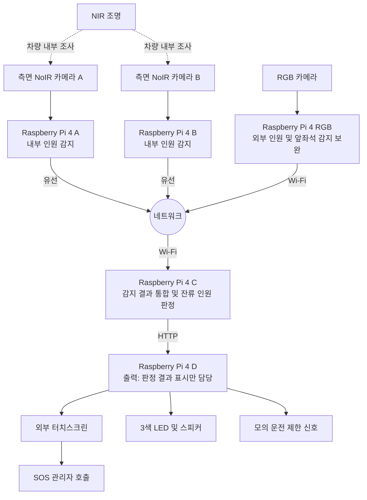

# 기계식 주차장 차량 내 잔류 인원 감지 시스템

**On-Device AI for Vehicle Occupant Detection**

> 현대 AI Campus · 온디바이스 AI 프로젝트  
> Team. 멈춰조 · 2026.11.20 ~ 2026.12.10

`On-Device AI` `Computer Vision` `Raspberry Pi 4` `Near-Infrared` `Blender`

## 1. 프로젝트 소개

기계식 주차장에 차량을 입고하기 전, 차량 외부에 설치된 카메라를 통해 차량 내부에 남아 있는 사람을 감지하는 온디바이스 AI 안전 시스템을 개발합니다.

운전자가 차량에서 하차하더라도 뒷좌석에 동승자나 수면 상태의 탑승자가 남아 있을 수 있습니다. 기존의 차량 외부 인원 및 퇴장 여부 확인 방식에서 발생할 수 있는 사각지대를 보완하기 위해 근적외선 기반 차량 내부 감지와 외부 인원 감지를 결합합니다.

### 개발 목표

- 차량 내부 잔류 인원 감지 및 인원 수 추정
- 다중 카메라를 활용한 사각지대 및 미검출 감소
- Raspberry Pi 4 기반 실시간 영상 처리 및 로컬 AI 추론
- 위험 상황에서 주차설비 운전 제한 신호 및 이용자 안내 제공
- 기존 기계식 주차시설에도 적용하기 쉬운 저비용 시스템 구현

## 2. 주요 기능

| 기능 | 설명 |
| --- | --- |
| 차량 내부 인원 감지 | 측면 NoIR 카메라와 NIR 조명을 이용한 앞좌석·뒷좌석 탑승자 감지 |
| 차량 외부 인원 감지 | RGB 카메라를 이용한 운전자 퇴장 및 주변 인원 확인 |
| 다중 카메라 감지 | 서로 다른 시점에서의 감지 결과를 통합하여 사각지대 보완 |
| 유리창 개방 안내 | 짙은 선팅 등으로 내부 확인이 어려울 경우 유리창 개방 안내 및 재검사 |
| 상태 표시 및 경보 | 터치스크린, 스피커, 3색 LED를 이용한 상태 및 조치 방법 안내 |
| 관리자 호출 | 외부 조작부의 SOS 버튼을 통한 관리자 호출 |

## 3. 시스템 아키텍처

아래는 현재 설계 단계의 개념도이며, 카메라 수량 및 통신 방식은 실험 결과에 따라 변경될 수 있습니다.
보드별 역할, 판단 원칙, 상태 전이와 판정 규칙은 [시스템 구조 문서](./docs/ARCHITECTURE.md)에 정리되어 있습니다.

### 카메라 배치

- NoIR 카메라: 차량 측면에 배치하며 앞좌석과 뒷좌석을 가능한 한 함께 촬영합니다.
- NIR 조명: NoIR 카메라 하단에 배치합니다.
- RGB 카메라: NoIR 카메라의 앞좌석 감지 성능에 따라 역할과 설치 위치를 결정합니다.

| NoIR 앞좌석 감지 성능 | NoIR 역할 | RGB 역할 |
| --- | --- | --- |
| 충분한 경우 | 앞좌석 + 뒷좌석 감지 | 차량 외부 인원 감지 |
| 불충분한 경우 | 뒷좌석 중심 감지 | 앞좌석 + 차량 외부 인원 감지 (차량 전면의 높은 위치 검토) |

소형 차량과 카니발급 대형 차량의 차체 크기 및 좌석 배치가 다르므로 카메라 높이, 거리, 화각을 차량별로 검증합니다.

### On-Device AI 적용 이유

- 별도 추론 서버 및 클라우드 운영 비용 절감 가능
- 외부 서버 의존성 감소 및 시스템 구성 간소화
- 기존 주차시설에 추가 설치하기 쉬운 구조
- 차량 내부 영상의 외부 전송 최소화

## 4. Hardware & Software

| 구분 | 구성 | 비고 |
| --- | --- | --- |
| Edge Device | Raspberry Pi 4 | 5대: 카메라 노드 3대(NoIR A·B, RGB) + 판정 1대(C) + 출력 1대(D) |
| Interior Camera | Raspberry Pi NoIR Camera | 2대 기본안, 차량 측면 |
| Exterior Camera | RGB Camera | 수량 및 위치 검토 중 |
| Illumination | NIR LED | 카메라 하단 배치 |
| User Interface | 터치스크린, 스피커, 3색 LED | 외부 이용자 안내 |
| Object Detection | YOLO 계열 | 최종 모델 및 입력 해상도 선정 예정 |
| Synthetic Dataset | Blender | 합성 영상 및 학습 라벨 생성 |
| Communication | 보드 간 결과 전송 및 통합 | 통신 방식 선정 예정 |

## 5. Dataset & Model Training

합성 데이터 기반으로 초기 모델을 구축하고, 실제 데이터를 단계적으로 추가하여 실제 환경에 대한 감지 성능을 보완합니다.

| 데이터셋 | 취득 방법 | 목적 |
| --- | --- | --- |
| Synthetic Dataset | Blender 기반 합성 데이터 생성 | 초기 모델 학습 및 MVP 구현 |
| DriveFace | 이용 승인 및 데이터 적합성 확인 후 확보 | 실사 데이터 추가 및 모델 보완 |
| Real-world Dataset | 팀 자체 촬영 (12/5~12/6 예정) | 실제 환경 평가 및 Edge Case 보완 |

### 데이터 생성 및 촬영 조건

| 항목 | 조건 |
| --- | --- |
| 실차 | 9인승 카니발 |
| Blender 차량 에셋 | 아이오닉 9 (활용 예정) |
| 좌석 범위 | 3열을 차단하고 1·2열만 사용하는 5인승 조건 |
| 탑승 인원 | 0~5명 |
| 자세 | 앉아 있는 자세, 누워 있는 자세 |
| 가림 요소 | 모자, 담요, 좌석 및 차체에 의한 가림 |
| 촬영 조건 | 차량 외부 측면, 조명, 선팅, 유리창 개방 여부 등 |
| 라벨 | 사람 Bounding Box 및 실제 탑승 인원 수 |

학습·검증·테스트 데이터는 차량 및 촬영 시퀀스 단위로 분리하여 데이터 누수를 방지합니다. DriveFace는 승인 및 이용 조건을 확인한 후 활용하며, 자체 촬영은 참여자와 시설 관리자의 동의를 받아 진행합니다.

## 6. Performance Evaluation

Raspberry Pi 4와 고사양 PC에서 동일한 모델과 입력 데이터를 사용해 추론 성능을 비교합니다. 워밍업 후 각 조건을 60초씩 측정하며 모델 추론 시간과 전체 파이프라인 처리 시간을 구분합니다.

| 평가 항목 | 지표 |
| --- | --- |
| 모델 크기 | Model Size (MB) |
| 처리 속도 | FPS, 평균 추론 지연시간 및 P95 (ms) |
| 병목 분석 | 전처리·추론·후처리 시간 (ms) |
| 자원 사용량 | CPU/GPU 사용률, 메모리 사용량 |
| 객체 검출 성능 | Precision, Recall, F1-score |
| 잔류 인원 감지 성능 | 잔류 여부 정확도, 미검출률 |
| 인원 수 추정 성능 | MAE |

추가적으로 단일/다중 카메라, 차량 크기, 선팅, 유리창 개방 여부, NIR 조명, 탑승 자세 및 가림 조건에 따른 감지 성능을 비교합니다.

> 정량적 실험 결과는 측정 완료 후 추가합니다. 사전 MVP 단계의 Pi 4 추론 성능과 통신 실험 결과는 [실험 기록](./docs/EXPERIMENTS.md)에 있습니다. 모델의 미검출만으로 안전을 보장할 수 없으므로 미검출률 및 판단 불가 상황을 중점적으로 검증합니다.

## 7. User Interface & Safety

차량 내부에 남은 인원의 자발적인 대응에 의존하지 않도록 이용자용 디스플레이는 차량 외부에 설치합니다. 고령자도 쉽게 사용할 수 있도록 큰 글씨, 높은 명암 대비, 상태 문구 및 도움말을 제공합니다.

| 상태 | LED | 의미 |
| --- | --- | --- |
| IDLE | 🟢 Green | 감지 구역이 비어 있는 대기 상태 |
| WARNING | 🟡 Yellow | 차량 내부 인원 감지, 확인 필요 |
| BLOCKED | 🔴 Red | 운전 불가 및 조치 필요 |

사람이 감지되거나 내부 확인이 불가능한 경우 운전 허가를 제한하는 방향으로 설계합니다. 짙은 선팅으로 내부 확인이 어려우면 유리창 개방을 안내하고 재검사를 진행하며, 계속 확인이 어려우면 관리자 확인을 요청합니다.

> 본 프로젝트는 안전 시스템의 프로토타입입니다. 운전 제한은 모의 인터록을 기준으로 개발하며, 실제 설비 연동에는 제조사 협의 및 별도 안전성 검증이 필요합니다. IDLE 표시 자체는 운전 허가를 의미하지 않습니다.

## 8. Project Schedule

| Phase | 기간 (2026년) | 주요 내용 |
| --- | --- | --- |
| Phase 0 | ~11/20 | 역할 분배 |
| Phase 0 | 11/21 ~ 11/24 | 사전 조사 및 지식 공유 |
| Phase 1 | 11/25 ~ 11/27 | 환경 구축, Dummy Test, 장비 세팅 |
| 시험 | 11/27 | 4과목 시험 (~Pruning) |
| Phase 2 | 11/28 ~ 12/02 | 합성 데이터 구축, 모델 학습·추론, MVP 구현 및 성능 측정 |
| Phase 3 | 12/03 ~ 12/07 | 성능 개선 및 주변 장치 연동 |
| Field Test | 12/05 ~ 12/06 | 실제 환경 테스트, 자체 데이터 촬영, Edge Case 보완 |
| Presentation | 12/08 ~ 12/09 | 최종 발표 자료 및 대본 작성 |
| Final Presentation | 12/10 | 최종 발표 |

## 9. Team

**멈춰조 (현대 AI Campus)**

팀원별 담당 업무 및 기여 내역은 역할 분배 내용을 바탕으로 업데이트할 예정입니다.

## 10. Project Documents

| 문서 | 내용 |
| --- | --- |
| [DECISIONS.md](./DECISIONS.md) | 기술 및 설계 의사결정, 결정 근거, 검증 항목, 후속 작업, 변경 이력 |
| [docs/ARCHITECTURE.md](./docs/ARCHITECTURE.md) | 시스템 구조: Pi 5대의 역할과 연결, 판단 원칙, 상태와 판정, 출력·관리자 알림, **코드 폴더 구조와 Pi별 설치·배포 규칙**, 아직 정하지 않은 항목 |
| [docs/UI_SCREEN.md](./docs/UI_SCREEN.md) | 화면·출력 연결 규격: 판정 Pi(C) → 출력 Pi(D) 통신(SSE), 상태 JSON v1, 화면·음성·신호등이 지켜야 할 안전 규칙 |
| [docs/EXPERIMENTS.md](./docs/EXPERIMENTS.md) | 엣지 케이스와 실험 기록: Pi 4 추론 성능, ESP32 워치독, 보드 간 통신(UDP 채택, Wi-Fi 지연) |
| [docs/coral/edge_tpu_research.md](./docs/coral/edge_tpu_research.md) | 비교군 모델과 Edge TPU INT8 변환 조사, Pi 4 + Coral 실행 제약 |
| [docs/coral/coral_sw_design.md](./docs/coral/coral_sw_design.md) | Coral 소프트웨어 설계: 변환·배포 파이프라인, 검출기 구조, 시험 계획과 현재 상태 |

---

현재 개발 중인 프로젝트이며, 확정된 실행 방법과 실험 결과는 개발 진행에 맞춰 업데이트할 예정입니다.
