# ExitGuard 카메라 배치 측정 보고서

- **작성일:** 2026-11-26
- **목적:** 팀 회의에서 NoIR 카메라 설치값(위치·거리·높이·각도)을 다시 정하기 위한 근거 자료
- **시작 요청:** "측정해서 비교해 주고 결과를 보여줘. 안 되면 카니발 기준으로, 원래 하려던 1열까지 다 보이는 걸로 만들어 주고 결과를 보여줘"
- **환경:** 설계서 v0.1 / `tower_spec_v0.1.json` (현대엘리베이터 오토발렛 ARBLT18 승하차장, 카메라 NoIR-L·R 2대 + IR 조명 2개)

## 한눈에 보는 결론

| 질문 | 결과 |
|---|---|
| 기존 깃허브 배치(차에서 0.30 m, 높이 1.5 m, 아래 30°)로 1열이 보이나? | **약함.** 5명 탑승 시 1열 조수석 40%, 2열 가운데 7% (상황 1) |
| 아반떼급부터 카니발까지 한 배치로 다 보이나? | **불가.** 세단(엘란트라N)은 162가지 설정 중 최대 31% (상황 2) |
| 카니발 기준으로 1열까지 보이는 배치는? | **가능.** x 2.6 m · 차에서 0.95 m · 높이 1.5 m · 아래 10° → 5명 탑승 시 1열 86% / 57%, 2열 79~93% (상황 3) |
| 양쪽 카메라가 있는데 1열 조수석이 왜 57%? | 반대편 카메라는 **운전자 몸에 완전히 가림(0%)**, 같은 쪽 카메라는 **긴 머리카락이 얼굴을 덮음** (상황 4) |
| ix35까지 포함한 공통 배치는? | **가능.** 높이만 1.3 m로 → 1명씩 모든 좌석 70% 이상 (상황 5). 단, **카시트 아기 0%** |
| 누운 사람·바닥은? | **측면 카메라로는 어려움.** 어떤 설정에서도 누운 아이 최대 22%, 바닥 최대 38% (상황 6) |

## 측정 방법

- **도구:** Blender 4.2 (Cycles). 차 3D 모델: 엘란트라N(아반떼급 세단), ix35, 팰리세이드. **카니발 모델이 없어 크기가 거의 같은 팰리세이드로 대신 측정**(전폭 1.975 vs 1.995 m, 전고 약 1.78 vs 1.775 m).
- **정차:** 앞범퍼 = 팀 원점(x = 0), 승하차장 가운데(y = 0). 카메라는 승하차장에 고정되어 차가 달라도 같은 자리.
- **좌표:** 팀 깃허브 좌표계 (+x 차 뒤쪽, +y 조수석 쪽, +z 위). "차에서 거리" = 카니발 옆면에서 카메라까지.
- **카메라:** Camera Module 3 Wide 가정 (깃허브 DEC-010) — 수평 화각 102°, 화면 16:9 (수직 약 70°).
- **지표 = 보이는 비율:** 사람 몸(또는 머리) 표면 점 중, 화면 안에 있고 카메라에서 가려지지 않은 점의 비율.
  - 가림 판정은 학습 라벨과 같은 규칙: 차체·좌석·다른 사람에 막히면 안 보임, 유리를 68° 이상 비스듬히 보면 반사로 안 보임.
  - **"좋은 쪽"** = NoIR-L(운전석 쪽)과 NoIR-R(조수석 쪽) 중 더 잘 보는 카메라 값.
- **1명씩 측정:** 좌석마다 같은 성인(남 28세, 키 1.78 m)을 앉혀 측정 → 그 좌석을 볼 수 있는 한계.
- **5명 측정:** 성인 5명(남·여, 긴 머리 포함)을 모두 태워 측정 → 서로 가림 포함.
- **한계:** 렌즈 왜곡 없음, 깃허브의 "유효 반경 2.0 m" 미적용(거리 제한 없음), 선팅 없음(맑은 유리).

---

## 상황 1. 기존 깃허브 배치 그대로 측정

배치: x 3.29 m · 차에서 0.30 m · 높이 1.50 m · 아래 30° (깃허브 DEC-010). 차: 팰리세이드, 5명 탑승.

| NoIR-L (운전석 쪽) | NoIR-R (조수석 쪽) |
|---|---|
| 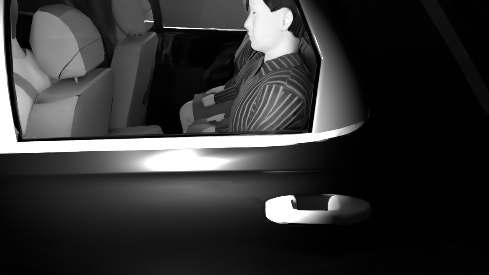 | 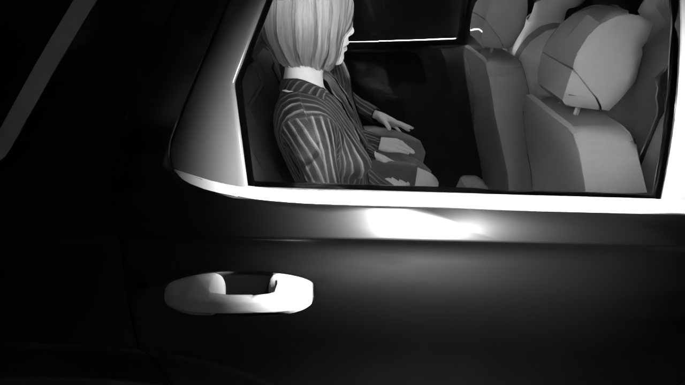 |

| 위에서 본 배치 | 비스듬히 본 배치 |
|---|---|
| 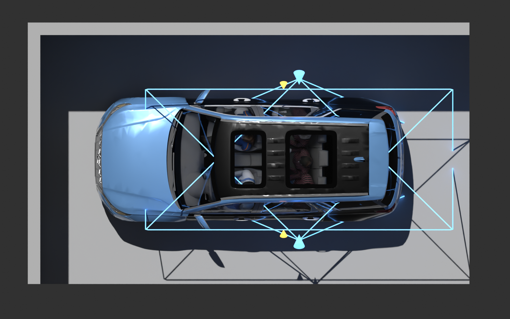 | 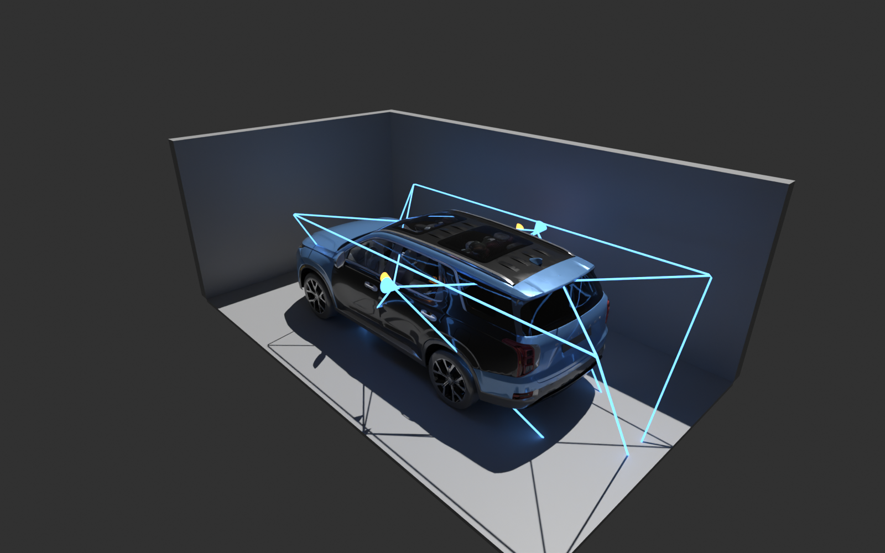 |

파란 원뿔 = NoIR 카메라, 노란 원뿔 = IR 조명, 파란 선 = 화각(2 m까지). 화각은 차 앞~뒤를 모두 덮는다.

**1명씩 (팰리세이드)**

| 대상 | L 머리 | R 머리 | **머리 (좋은 쪽)** | L 몸 | R 몸 | **몸 (좋은 쪽)** |
|---|---|---|---|---|---|---|
| 1열 운전석 | 29% | 86% | **86%** | 19% | 40% | **40%** |
| 1열 조수석 | 85% | 39% | **85%** | 38% | 28% | **38%** |
| 2열 왼쪽(운전석 뒤) | 45% | 99% | **99%** | 37% | 80% | **80%** |
| 2열 가운데 | 62% | 64% | **64%** | 68% | 68% | **68%** |
| 2열 오른쪽(조수석 뒤) | 96% | 45% | **96%** | 81% | 38% | **81%** |

**5명 탑승 (서로 가림 포함)**

| 대상 | L 머리 | R 머리 | **머리 (좋은 쪽)** | L 몸 | R 몸 | **몸 (좋은 쪽)** |
|---|---|---|---|---|---|---|
| 1열 운전석 | 29% | 86% | **86%** | 19% | 40% | **40%** |
| 1열 조수석 | 40% | 24% | **40%** | 16% | 10% | **16%** |
| 2열 왼쪽(운전석 뒤) | 68% | 0% | **68%** | 40% | 25% | **40%** |
| 2열 가운데 | 7% | 0% | **7%** | 19% | 4% | **19%** |
| 2열 오른쪽(조수석 뒤) | 27% | 35% | **35%** | 34% | 26% | **34%** |

- 카메라가 차에서 30 cm라 **창문 하나만 보이고 화면 아래 절반은 문짝**이다.
- 가까운 2열 사람은 **머리가 화면 위로 잘린다** (머리가 화면 안에 들어오는 비율 약 50%).
- 1열은 **B필러·등받이·2열 사람**에 가려 몸이 19~40%만 보인다.

---

## 상황 2. 아반떼급~카니발 공통 배치 찾기 (162가지 설정)

바꾼 값: 앞뒤 x 2.6 / 2.9 / 3.2 m · 차에서 0.30 / 0.60 / 0.95 m · 높이 1.3 / 1.4 / 1.5 m · 아래 10 / 20 / 30° · 앞쪽으로 돌림 0 / 15°. 좌석마다 1명씩, **머리 보이는 비율 (좋은 쪽)**.

| 배치 | 차 | 1열 운전석 | 1열 조수석 | 2열 왼쪽(운전석 뒤) | 2열 가운데 | 2열 오른쪽(조수석 뒤) | **가장 나쁜 좌석** |
|---|---|---|---|---|---|---|---|
| 깃허브 배치에 가장 가까운 값 | elantraN | 3% | 3% | 49% | 32% | 44% | **3%** |
| 깃허브 배치에 가장 가까운 값 | ix35 | 54% | 52% | 32% | 35% | 34% | **32%** |
| 깃허브 배치에 가장 가까운 값 | palisade | 85% | 82% | 99% | 61% | 96% | **61%** |
| 세 차 공통 1위 | elantraN | 31% | 32% | 53% | 33% | 49% | **31%** |
| 세 차 공통 1위 | ix35 | 78% | 84% | 77% | 52% | 82% | **52%** |
| 세 차 공통 1위 | palisade | 88% | 86% | 98% | 98% | 99% | **86%** |

- 깃허브 배치에 가장 가까운 값 = x 3.2 m · 차에서 0.3 m · 높이 1.5 m · 아래 30° · 앞쪽 0°
- 세 차 공통 1위 = x 2.6 m · 차에서 0.95 m · 높이 1.4 m · 아래 10° · 앞쪽 0°
- **세단(엘란트라N)은 162가지 중 어떤 설정에서도 가장 나쁜 좌석이 31%를 넘지 못했다.** 창문이 낮고(위끝 약 1.34 m) 좁아 머리가 지붕 틀에 걸린다.
- → **아반떼급까지 한 배치로 커버하는 것은 불가. 카니발 기준으로 진행.**

---

## 상황 3. 카니발 기준, 1열까지 보이는 새 배치

배치: **x 2.6 m · 차에서 0.95 m · 높이 1.5 m · 아래 10° · 앞쪽 0°** (IR 조명은 깃허브 규칙대로 카메라보다 앞 0.25 m, 차 쪽 0.12 m, 아래 0.02 m).

| NoIR-L (운전석 쪽) | NoIR-R (조수석 쪽) |
|---|---|
| 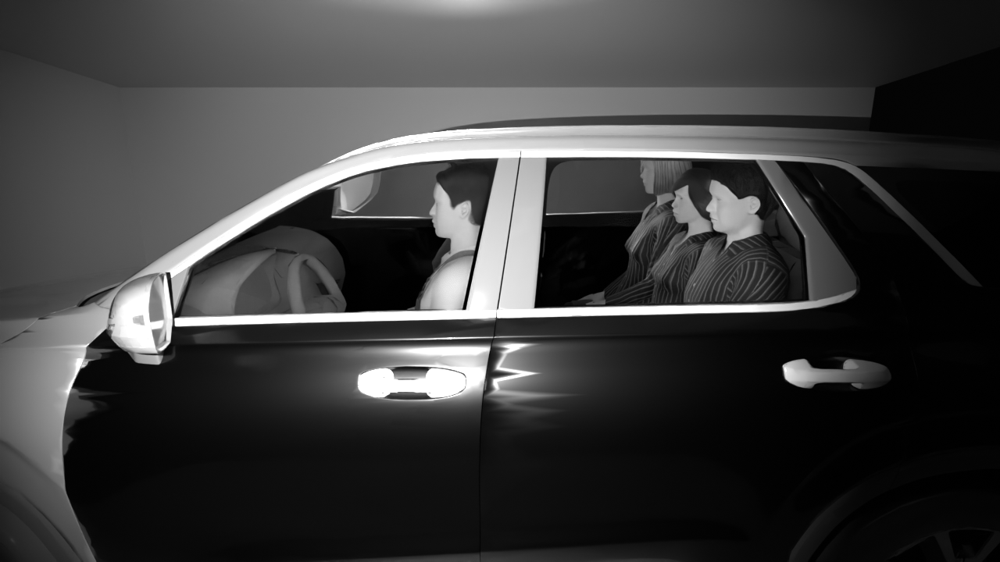 | 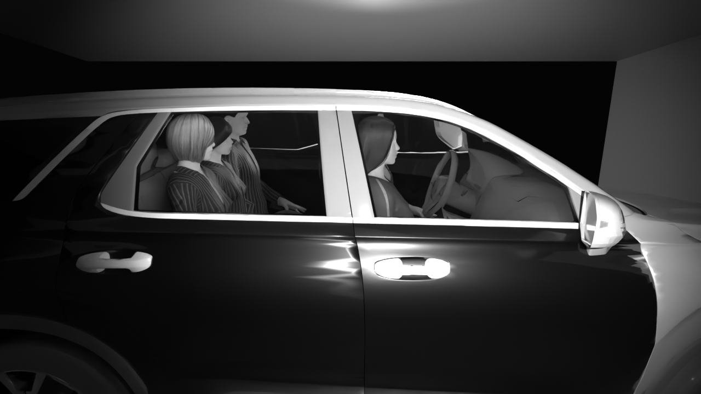 |

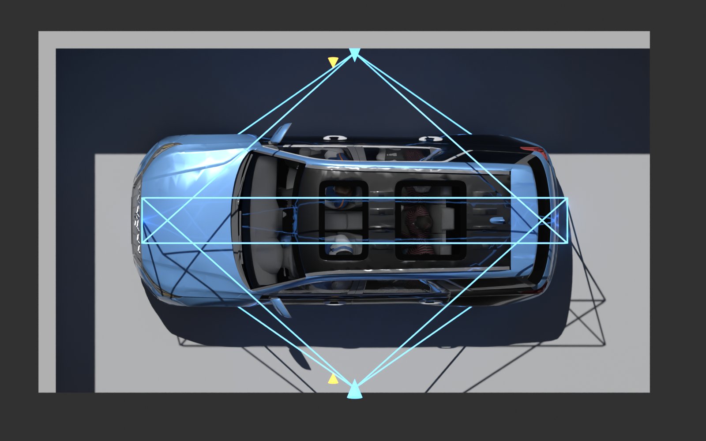

**5명 탑승 비교 — 머리 보이는 비율 (좋은 쪽)**

| 좌석 | 깃허브 배치 (0.30 m, 1.5 m, 아래 30°) | **카니발 기준 새 배치 (0.95 m, 1.5 m, 아래 10°)** | 공통 배치 (0.95 m, 1.3 m, 아래 10°) |
|---|---|---|---|
| 1열 운전석 | 86% | **86%** | 85% |
| 1열 조수석 | 40% | **57%** | 57% |
| 2열 왼쪽(운전석 뒤) | 68% | **93%** | 92% |
| 2열 가운데 | 7% | **92%** | 93% |
| 2열 오른쪽(조수석 뒤) | 35% | **79%** | 78% |

**새 배치 5명 탑승 상세**

| 대상 | L 머리 | R 머리 | **머리 (좋은 쪽)** | L 몸 | R 몸 | **몸 (좋은 쪽)** |
|---|---|---|---|---|---|---|
| 1열 운전석 | 86% | 2% | **86%** | 44% | 1% | **44%** |
| 1열 조수석 | 0% | 57% | **57%** | 0% | 23% | **23%** |
| 2열 왼쪽(운전석 뒤) | 93% | 82% | **93%** | 45% | 53% | **53%** |
| 2열 가운데 | 92% | 64% | **92%** | 34% | 27% | **34%** |
| 2열 오른쪽(조수석 뒤) | 79% | 52% | **79%** | 42% | 29% | **42%** |

- 앞문·슬라이딩도어 **창문 두 개가 화면에 다 들어오고 1열·2열 5명이 모두 보인다.**
- 2열 가운데가 7% → 92%로 가장 크게 좋아졌다.
- 카메라가 승하차장 가장자리(차에서 0.95 m)라 **벽 또는 천장 브래킷 설치**가 필요하다.

---

## 상황 4. 양쪽 카메라가 있는데 1열 조수석이 왜 57%인가

팰리세이드, 새 배치 계열(차에서 0.95 m, 아래 10°, 높이 1.3 m)에서 1열 조수석 머리만 따로 측정.

| 상황 | NoIR-L (운전석 쪽) | NoIR-R (조수석 쪽) | 가린 것 |
|---|---|---|---|
| 짧은 머리 남자 혼자 | 60% | **83%** | 차체·좌석 |
| 긴 머리 여자 혼자 | 44% | 56% | **자기 머리카락**(얼굴·목을 덮음), 차체·좌석 |
| 긴 머리 여자 + 5명 탑승 | **0%** | 56% | L: **운전석 사람이 완전히 가림** / R: 자기 머리카락 |

- 반대편 카메라(L)는 조수석을 보려면 **운전자를 통과해서 봐야** 하므로, 운전석에 사람이 있으면 0%.
- 같은 쪽 카메라(R)는 다른 사람에게 가리지 않는다. 낮은 값은 **긴 머리카락이 옆얼굴을 덮은 것**이 원인이고, 렌더 이미지에서는 사람이 뚜렷하게 보인다.
- → **1열은 사실상 같은 쪽 카메라 하나가 책임지는 구조.**

---

## 상황 5. ix35까지 포함한 공통 배치 (아반떼급 제외)

배치: **x 2.6 m · 차에서 0.95 m · 높이 1.3 m · 아래 10° · 앞쪽 0°**. 상황 3에서 높이만 1.5 → 1.3 m.

**1명씩 — 머리 보이는 비율 (좋은 쪽)**

| 배치 | 차 | 1열 운전석 | 1열 조수석 | 2열 왼쪽(운전석 뒤) | 2열 가운데 | 2열 오른쪽(조수석 뒤) | **가장 나쁜 좌석** |
|---|---|---|---|---|---|---|---|
| 공통 배치 (1.3 m) | ix35 | 70% | 77% | 79% | 82% | 95% | **70%** |
| 공통 배치 (1.3 m) | palisade | 84% | 83% | 97% | 98% | 98% | **83%** |
| 카니발 기준 (1.5 m) | ix35 | 44% | 46% | 46% | 44% | 47% | **44%** |
| 카니발 기준 (1.5 m) | palisade | 88% | 88% | 98% | 99% | 99% | **88%** |

**5명 탑승**

ix35:

| 대상 | L 머리 | R 머리 | **머리 (좋은 쪽)** | L 몸 | R 몸 | **몸 (좋은 쪽)** |
|---|---|---|---|---|---|---|
| 1열 운전석 | 47% | 29% | **47%** | 33% | 11% | **33%** |
| 1열 조수석 | 23% | 48% | **48%** | 7% | 25% | **25%** |
| 2열 왼쪽(운전석 뒤) | 62% | 54% | **62%** | 35% | 25% | **35%** |
| 2열 가운데 | 74% | 49% | **74%** | 23% | 17% | **23%** |
| 2열 오른쪽(조수석 뒤) | 69% | 37% | **69%** | 29% | 22% | **29%** |

팰리세이드:

| 대상 | L 머리 | R 머리 | **머리 (좋은 쪽)** | L 몸 | R 몸 | **몸 (좋은 쪽)** |
|---|---|---|---|---|---|---|
| 1열 운전석 | 85% | 0% | **85%** | 40% | 0% | **40%** |
| 1열 조수석 | 0% | 57% | **57%** | 0% | 21% | **21%** |
| 2열 왼쪽(운전석 뒤) | 92% | 75% | **92%** | 44% | 37% | **44%** |
| 2열 가운데 | 93% | 73% | **93%** | 30% | 25% | **30%** |
| 2열 오른쪽(조수석 뒤) | 78% | 53% | **78%** | 34% | 26% | **34%** |

| ix35 NoIR-L | ix35 NoIR-R |
|---|---|
| 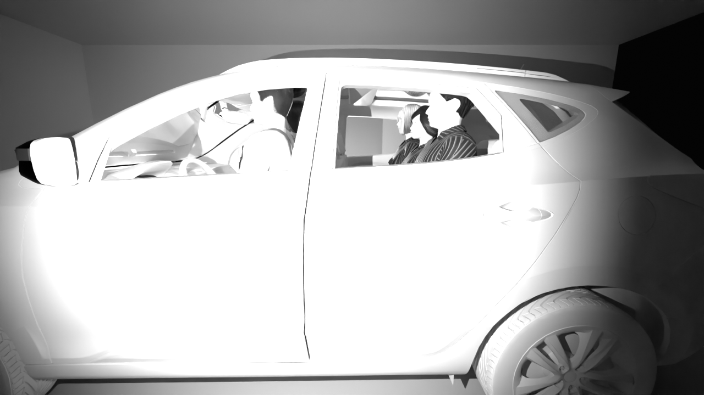 | 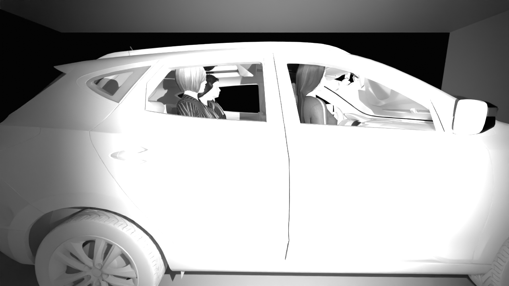 |

| 팰리세이드 NoIR-L | 팰리세이드 NoIR-R |
|---|---|
| 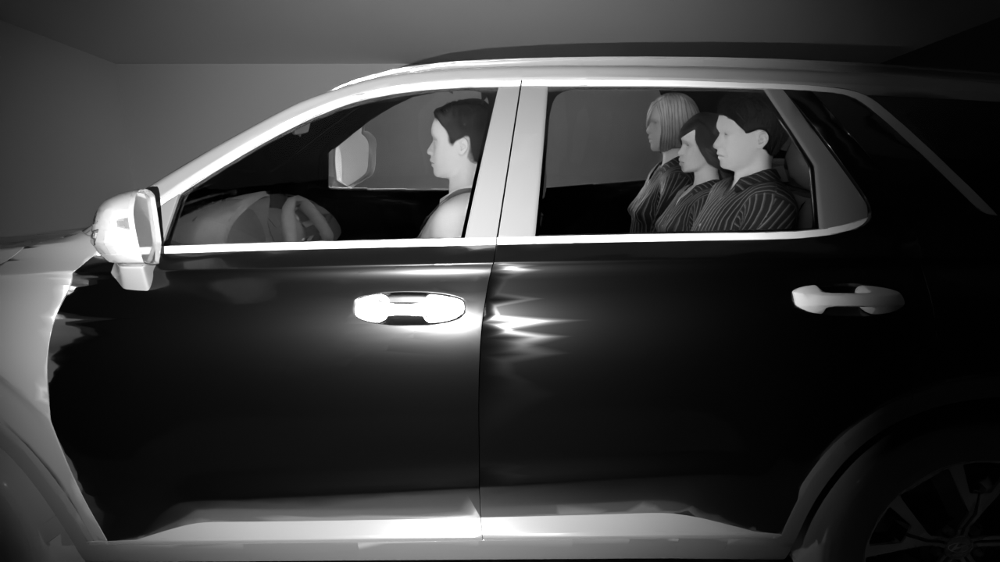 | 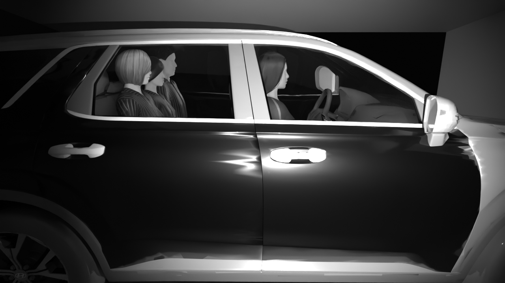 |

- 높이 1.3 m는 **카니발(팰리세이드) 결과를 거의 잃지 않으면서 ix35를 크게 개선**한다 (1명씩 ix35 가장 나쁜 좌석 43% → 70%).
- ix35는 5명이 다 타면 1열이 50% 아래.
- **단점: 높이 1.3 m에서는 카시트 아기가 0%** (상황 6).

---

## 상황 6. 누운 사람·바닥·카시트 아기

대상: 2열에 엎드려 누운 아이(4세), 2열 앞 바닥에 앉은 아이(6세), 2열 오른쪽 뒤보기 카시트의 아기(1세), 비교용 앉은 성인. 64가지 설정(x 2.6/3.0, 차에서 0.6/0.95 m, 높이 1.3/1.5/1.7/1.9 m, 아래 10~40°). 1명씩 측정, 앉은 성인은 머리·나머지는 몸 전체 비율 (좋은 쪽). 높이·거리마다 앉은 성인이 가장 잘 보이는 설정을 골랐다 (아래 각도는 결과 차이가 거의 없음).

**팰리세이드 (카니발 대신)**

| 높이 | 차에서 거리 | 앞뒤 x | 1열 운전석 | 1열 조수석 | 2열 가운데 | 2열에 누운 아이 | 바닥에 앉은 아이(왼쪽) | 바닥에 앉은 아이(오른쪽) | 카시트 아기(2열 오른쪽) |
|---|---|---|---|---|---|---|---|---|---|
| 1.3 m | 0.6 m | 2.6 | 81% | 79% | 97% | 0% | 0% | 0% | 1% |
| 1.3 m | 0.95 m | 2.6 | 84% | 83% | 98% | 0% | 0% | 0% | 0% |
| 1.5 m | 0.6 m | 2.6 | 87% | 86% | 98% | 1% | 6% | 4% | 55% |
| 1.5 m | 0.95 m | 2.6 | 88% | 88% | 99% | 0% | 0% | 0% | 54% |
| 1.7 m | 0.6 m | 2.6 | 85% | 84% | 58% | 18% | 14% | 13% | 57% |
| 1.7 m | 0.95 m | 2.6 | 87% | 88% | 64% | 4% | 14% | 14% | 57% |
| 1.9 m | 0.6 m | 2.6 | 44% | 41% | 10% | 22% | 13% | 13% | 59% |
| 1.9 m | 0.95 m | 2.6 | 58% | 51% | 25% | 18% | 16% | 16% | 59% |

**ix35**

| 높이 | 차에서 거리 | 앞뒤 x | 1열 운전석 | 1열 조수석 | 2열 가운데 | 2열에 누운 아이 | 바닥에 앉은 아이(왼쪽) | 바닥에 앉은 아이(오른쪽) | 카시트 아기(2열 오른쪽) |
|---|---|---|---|---|---|---|---|---|---|
| 1.3 m | 0.6 m | 3.0 | 61% | 63% | 98% | 0% | 0% | 0% | 0% |
| 1.3 m | 0.95 m | 2.6 | 70% | 77% | 82% | 0% | 0% | 0% | 0% |
| 1.5 m | 0.6 m | 2.6 | 38% | 40% | 45% | 0% | 5% | 5% | 65% |
| 1.5 m | 0.95 m | 2.6 | 44% | 46% | 44% | 0% | 0% | 0% | 53% |
| 1.7 m | 0.6 m | 2.6 | 17% | 15% | 7% | 5% | 31% | 32% | 67% |
| 1.7 m | 0.95 m | 2.6 | 19% | 18% | 8% | 0% | 18% | 20% | 66% |
| 1.9 m | 0.6 m | 3.0 | 9% | 9% | 7% | 19% | 38% | 35% | 71% |
| 1.9 m | 0.95 m | 3.0 | 11% | 9% | 6% | 4% | 35% | 35% | 70% |

**장면 측정 (팰리세이드, 여러 명 함께)**

| 대상 | 높이 1.5 m (x 2.6, 차에서 0.6 m) 머리 / 몸 | 높이 1.9 m (x 3.0, 차에서 0.6 m) 머리 / 몸 |
|---|---|---|
| 1열 운전석 (앉은 성인) | 85% / 53% | 18% / 24% |
| 2열에 누운 아이 | 0% / 1% | 0% / 22% |
| 바닥에 앉은 아이(2열 왼쪽 앞) | 15% / 6% | 40% / 30% |
| 카시트 아기(2열 오른쪽) | 81% / 55% | 94% / 60% |

| 높이 1.5 m — 누운 아이 (NoIR-L / R) | 높이 1.9 m — 누운 아이 (NoIR-L / R) |
|---|---|
| 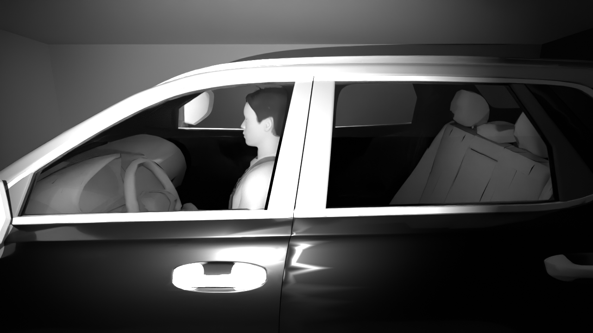  | 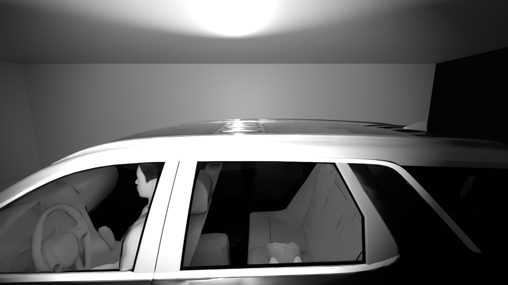 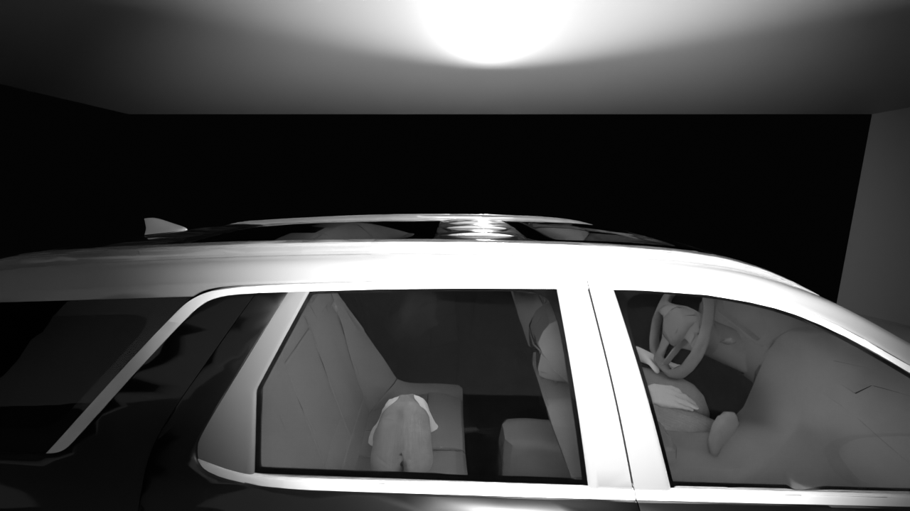 |

| 높이 1.5 m — 바닥 아이 + 카시트 아기 (L / R) | 높이 1.9 m — 바닥 아이 + 카시트 아기 (L / R) |
|---|---|
| 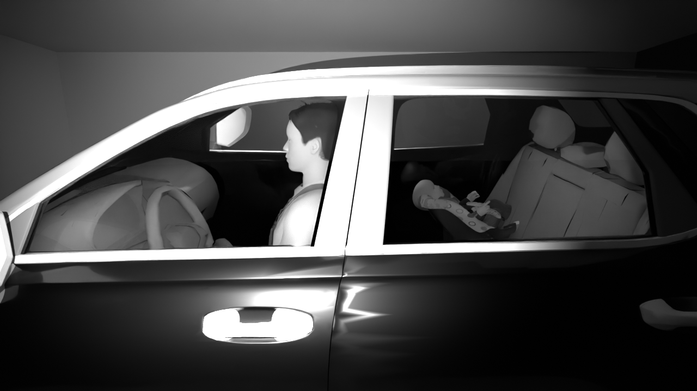 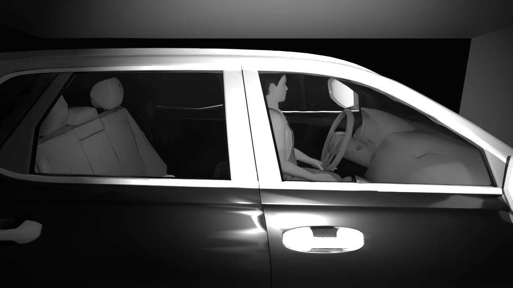 | 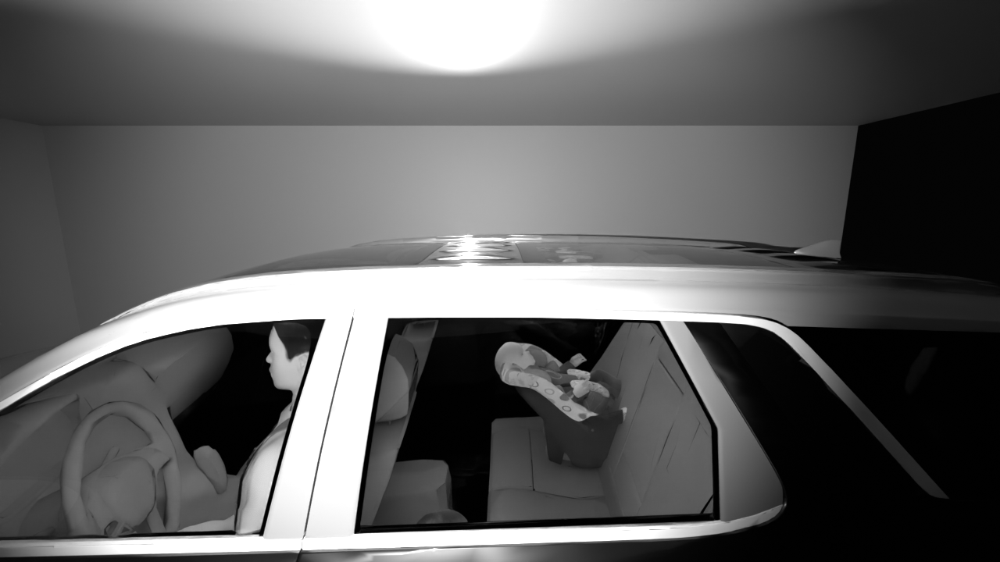 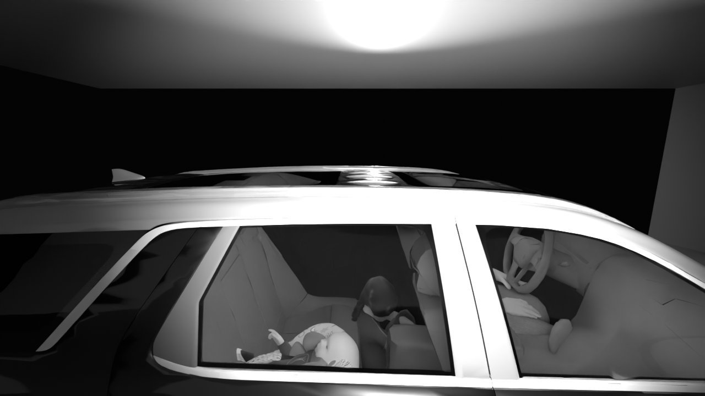 |

- **높이를 올리면** 바닥·카시트·누운 대상은 좋아지지만 **앉은 사람 머리가 지붕선에 걸려 크게 나빠진다** (팰리세이드 1.9 m: 1열 16~19%, 2열 가운데 10%).
- 카니발 창 위끝 1.62 m, 지붕 1.74 m → **1.9 m 카메라는 지붕보다 높다.**
- **누운 아이는 어떤 설정에서도 최대 22%, 바닥은 최대 38%** → 측면 카메라로 해결하기 어렵다.
- **높이 1.3 m는 카시트 아기 0%**, 1.5 m는 약 55%.

---

## 참고. 화각과 1.9 m에 대하여

- 화각은 깃허브 DEC-010의 가정값(수평 102°, 수직 67°)을 썼다. Camera Module 3 Wide 공개 사양과 같다. 해상도 모드에 따라 실제 화각이 좁아질 수 있어 확인 필요.
- 법의 **1.9 m는 카메라 높이가 아니다**: 출입구 최소 높이(주차장법 시행규칙 제16조의5 ①2), 높이 1.9 m 이상 주차구획 30% 이상(같은 조 ①3).
- 깃허브의 "유효 반경 2.0 m"는 측정에 적용하지 않았다. 차에서 0.6~0.95 m 배치에서는 반대편 좌석까지 약 2.0~2.4 m라, 2.0 m가 조명 도달·인식 거리라면 반대편 좌석 값은 실제보다 좋게 나왔을 수 있다.

## 팀 회의에서 정할 것

1. **대상 차량 범위:** 카니발만 / 카니발 + ix35급 SUV (세단은 측면 2대로 불가)
2. **카메라 높이:** 1.5 m (카니발 최적, 카시트 아기 약 55%) / 1.3 m (ix35 포함, 카시트 아기 0%)
3. **차에서 거리:** 0.6 m (통로 덜 막음) / 0.95 m (승하차장 가장자리, 벽 설치)
4. **설치 방법:** 운전석 쪽은 사람이 내려 걷는 통로 → 벽·천장 브래킷 필요
5. **누운 사람·바닥:** 측면 카메라 한계로 명시하고 "판단 불가 → 창문 개방 안내 → 재검사" 절차로 처리할지
6. **"유효 반경 2.0 m"의 의미** 확인 (조명 도달 거리? 인식 거리?)
7. 실측(12/5~6)에서 같은 배치로 확인할 항목: 1열 조수석, 2열 가운데, 카시트

## 재현 방법

```powershell
# 1명씩 + 5명 측정 + 렌더 (설치값 지정: x,차에서거리,높이,아래각도,앞쪽각도)
blender -b C:\exitguard\scenes\car_palisade.blend --python C:\exitguard\tools\measure_tower_cams.py -- palisade C:\exitguard\docs\tower_spec_v0.1.json C:\exitguard\output\tower_measure "--cam=2.6,0.95,1.5,10,0"
# 설치값 162가지 비교 (앉은 성인) / 64가지 비교 (누운·바닥·카시트)
blender -b C:\exitguard\scenes\car_palisade.blend --python C:\exitguard\tools\sweep_tower_cams.py -- palisade C:\exitguard\output\tower_sweep
blender -b C:\exitguard\scenes\car_palisade.blend --python C:\exitguard\tools\sweep_tower_cams.py -- palisade C:\exitguard\output\tower_sweep low
# 이 보고서 다시 만들기
python C:\exitguard\tools\make_camera_report.py
```
